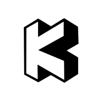

<h1 align="center">
    <br>
    <picture>
        <source media="(prefers-color-scheme: dark)" srcset="Resources/Branding/Kas_Logo_Dark_Square.png">
        <source media="(prefers-color-scheme: light)" srcset="Resources/Branding/Kas_Logo_Light_Square.png">
        
    </picture>
    <br>
    kas
    <br>
</h1>

<h4 align="center">An engine for easily creating interactive cross-platform 3D games</h4>

<p align="center">
    
    
</p>

## Getting Started

> This section describes Testbed build. Kas doesn't have an editor yet.

You'll need:
- CMake 3.21+ 
- C++ 17 capable compiler
- Vulkan SDK 1.4+
- Any build system supported by CMake (Ninja / VS 2022 / Make)

Start by cloning the repository with

``` powershell
git clone --recursive https://github.com/viskasssssss/kas.git
```

Now just build the repository

``` powershell
cmake -B build
cmake --build build
```

The result can be found in the build/bin/ folder

## Goal

The goal of kas is to create a powerful 3D game engine for easily building interactive and realistic games.

### Planned features:
- Luau Scripting
- Logic Circuits (visual scripting nodes used for easily writing logic for materials, objects, and much more)
- Support for Mac, Linux, XBOX and PlayStation
- High-fidelity physically-based 3D rendering
- Integrated third-party 3D physics engine